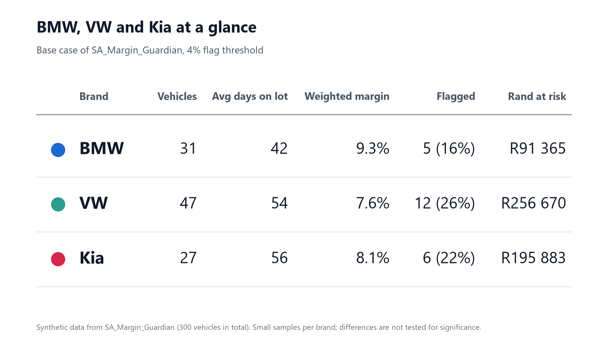
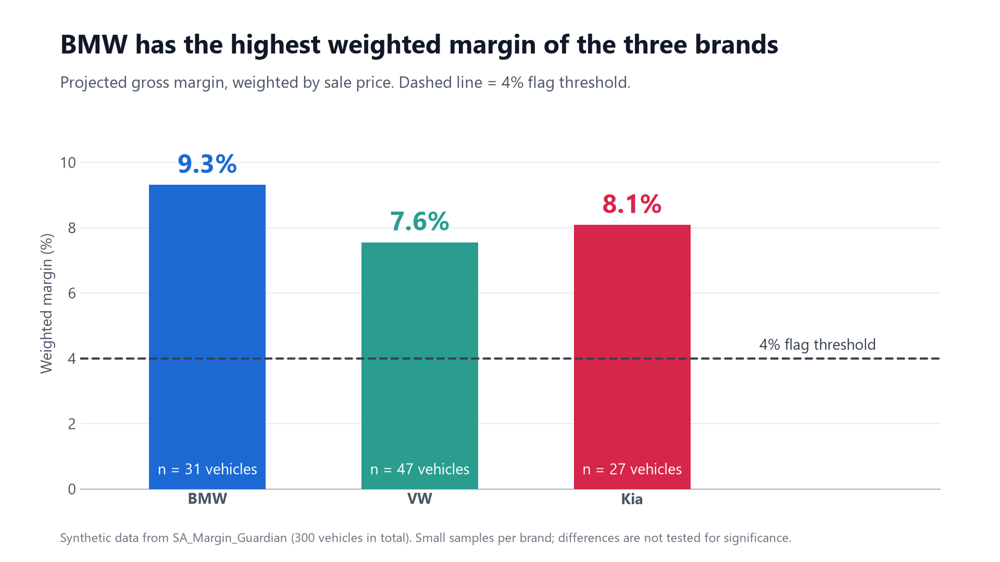
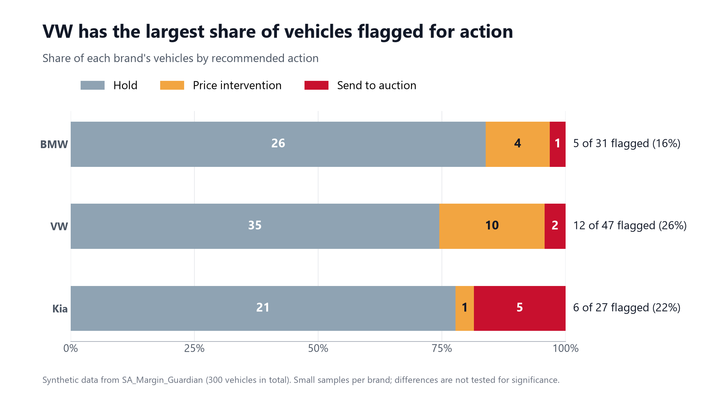
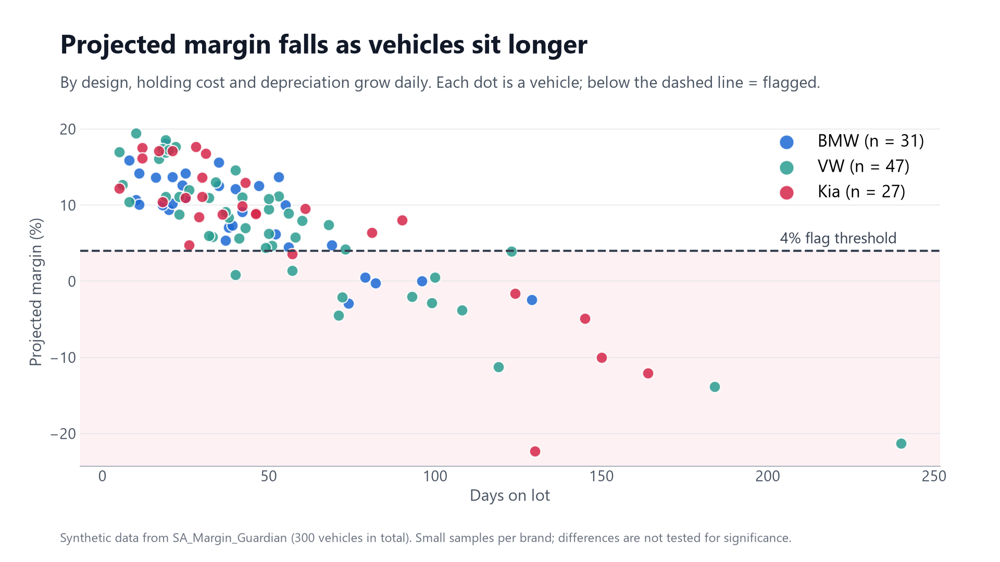

# SA Margin Guardian

**Which vehicles in South African dealer stock are heading for a thin or negative margin, and what should the dealer do about them?**


SA Margin Guardian is a data analysis project built on synthetic South African dealer stock (BMW, VW, Kia and other brands). It cleans a messy inventory file, projects each vehicle's gross margin after holding cost, floorplan interest and depreciation, flags vehicles below a margin threshold, and recommends one of three actions: **HOLD**, **PRICE INTERVENTION** or **SEND TO AUCTION**. Results are written to CSV, Excel, a SQLite database and charts.

> **Read this first**
> - **The data is synthetic.** It was generated to look like South African dealer stock. It is not real dealer data and it is not BMW data or BMW methodology.
> - **The results come from my assumptions.** Margin falls as days on lot rise because the formula charges holding cost and depreciation for every day. That is a built-in effect, not a discovery. The project shows a method that could be re-run on real data.
> - **AI was used as a tool.** I used AI assistants (Claude and GitHub Copilot) to help draft and review code. I set the business problem and the assumptions, and I tested the outputs. Knowledge from IBM SkillsBuild and WeThinkCode courses shaped the work.

## 1. The business problem

Dealers lose money when stock sits too long. Every extra day adds holding cost, floorplan interest and depreciation, and a wrong price can turn a sale into a loss. This project asks:

- Which vehicles are below the margin threshold (4% by default)?
- Which brands and locations hold the most rand at risk?
- How sensitive is the answer to the interest rate and cost assumptions?

## 2. Preview

Charts for BMW, VW and Kia, created by `Brands_visuals.py`:









Sample sizes per brand are small and differences are not tested for significance.

## 3. How it works

```
generate_data.py      ->  inventory_messy.csv, inventory_messy_key.csv
margin_guardian.py    ->  cleans, calculates margins, flags vehicles, recommends actions
                          inventory_clean.csv, rejected_rows.csv, cleaning_log.csv
                          margin_results.csv, margin_risk_summary.xlsx, margin.db
run_queries.py        ->  runs queries.sql on margin.db
sensitivity.py        ->  sensitivity.csv
Brands_visuals.py     ->  visuals/*.png
```

**Formulas** (all constants live in `config.py`):

```
holding_cost     = daily_overhead x days_on_lot
                   + acquisition_cost x (prime_rate + spread) x days_on_lot / 365
depreciation     = acquisition_cost x annual_rate_for_brand x days_on_lot / 365
projected_margin = (recommended_price - acquisition_cost - holding_cost - depreciation)
                   / recommended_price
```

- Floorplan interest uses the monthly SARB prime rate from `prime_rates.csv`.
- A vehicle is flagged when its projected margin is below `THRESHOLD_PCT` in `config.py`.
- The action rules (HOLD, PRICE INTERVENTION, SEND TO AUCTION) are set in the code and use values from `config.py`, so they can be edited and re-run.

## 4. Data cleaning

The messy input has extra spaces, inconsistent brand names, duplicate vehicle IDs, missing values and impossible numbers. The pipeline fixes what it safely can, rejects what it cannot, and logs every decision:

- `cleaning_log.csv`: what was changed or removed, and why
- `rejected_rows.csv`: rows that could not be used
- `inventory_messy_key.csv`: the key of problems that were deliberately injected, used to check the cleaning

## 5. SQL

`margin.db` is created when you run the pipeline (it is not stored in the repo) and holds the results. `queries.sql` contains the analysis queries and `run_queries.py` runs them and prints the output.

## 6. Sensitivity analysis

`sensitivity.py` re-runs the margin calculation under different assumptions and writes the outcome to `sensitivity.csv`, so you can see how the flagged count and the rand at risk move when inputs such as the prime rate, holding cost or threshold change.

## 7. Repository contents

| File | Purpose |
| --- | --- |
| `generate_data.py` | Builds the synthetic inventory, including the messy version |
| `inventory_sample.csv` | Small sample of stock rows |
| `inventory_messy.csv`, `inventory_messy_key.csv` | Messy input and the key of injected problems |
| `config.py` | Assumptions: costs, depreciation rates, threshold |
| `prime_rates.csv` | Monthly SARB prime rate used for floorplan interest |
| `margin_guardian.py` | Main pipeline: clean, calculate, flag, export |
| `inventory_clean.csv`, `rejected_rows.csv`, `cleaning_log.csv` | Cleaning outputs |
| `margin_results.csv`, `margin_risk_summary.xlsx` | Results in CSV and Excel |
| `queries.sql`, `run_queries.py` | SQL analysis |
| `sensitivity.py`, `sensitivity.csv` | Sensitivity analysis and its output |
| `Brands_visuals.py`, `visuals/` | BMW, VW and Kia comparison charts |
| `requirements.txt` | Python packages needed |
| `.gitignore` | Files kept out of Git |
| `LICENSE` | MIT License |

## 8. How to run

Windows PowerShell:

```powershell
git clone https://github.com/MMKatlego02/sa-margin-guardian.git
cd sa-margin-guardian
py -m venv .venv
.venv\Scripts\Activate.ps1
py -m pip install -r requirements.txt
py generate_data.py
py margin_guardian.py
py run_queries.py
py sensitivity.py
py Brands_visuals.py
```

Change values in `config.py` and re-run to see how the results move.

## 9. Limitations

- Synthetic data, so no conclusion here applies to a real dealer.
- Depreciation is a simple yearly rate per brand. Real values depend on model, mileage and condition.
- Gross margin only. Selling costs, VAT treatment and reconditioning are simplified.
- Small samples per brand and no significance testing.
- Static charts, not an interactive dashboard.

## 10. Next steps

- Replace synthetic data with real South African data from trusted sources, respecting each source's terms of use.
- Use real guide values (for example TransUnion or Lightstone) to test pricing, and check the prime rate history against the SARB website.
- Add confidence intervals or significance tests for brand comparisons.
- Add a dealer-level view of aged, low-margin stock for a stocking-finance lender.
- Build an interactive Power BI report.

## 11. Tech stack

`Python` `Pandas` `NumPy` `Matplotlib` `OpenPyXL` `SQLite` `SQL`

## 12. License

Released under the [MIT License](LICENSE).

---

**Built by [MMKatlego02](https://github.com/MMKatlego02)** | Data analyst portfolio project
